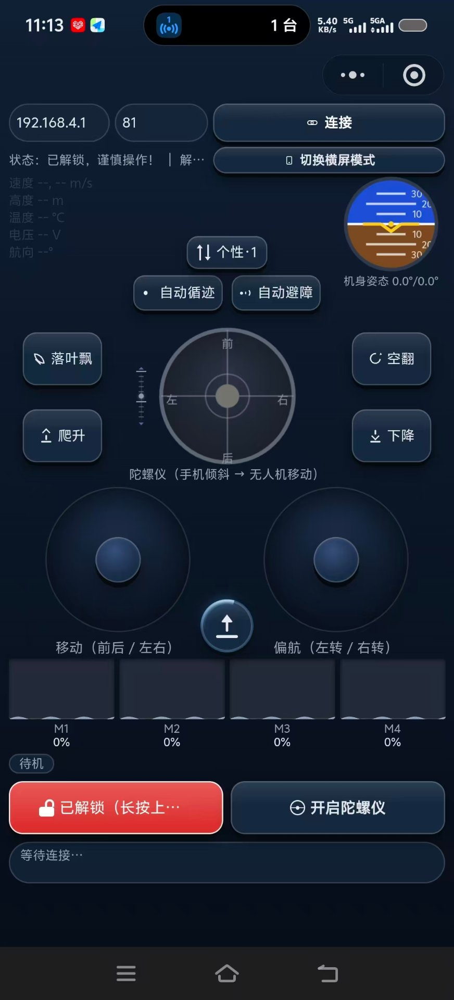
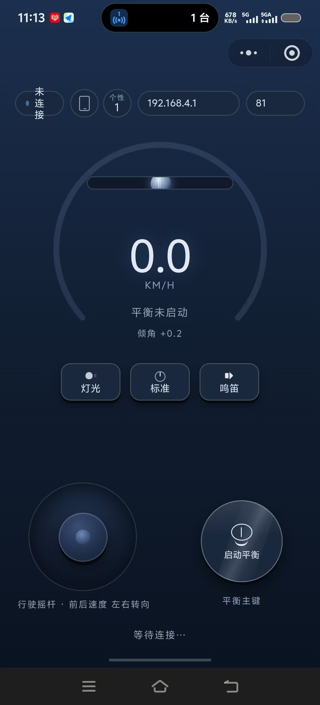
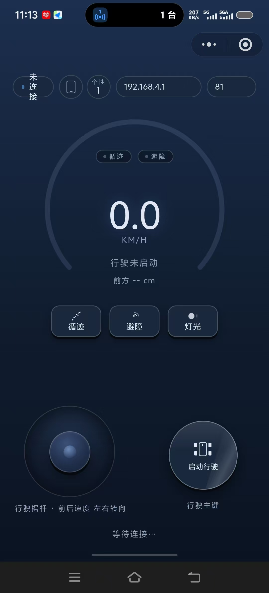

# TREE·LINK 微信小程序控制端

一部微信小程序，同时管住三台设备：**12cm 室内无人机 · 平衡车 · 智能车**。
选择控制页用卡片翻面切换模式，三个控制页均支持横竖屏，配三套可切换的个性皮肤（钢穹 / 紫电 / 极昼）。

<div align="center">
  
  
  
</div>

## 功能特性

### 控制
- **无人机页**：姿态球 / HUD（canvas 逐帧绘制）、电机液面柱、一键起飞、特技键（落叶飘 / 空翻）、按住升降（叠加在 ToF 定高环上）
- **平衡车页**：SPD 弧形进度盘、摇杆利萨如、油门液面
- **智能车页**：循迹 / 避障 / 灯光三键开关
- **摇杆**：逻辑层 `catchtouch*` 驱动，16ms 按帧合并 + 0.5px 量化，双摇杆互不干扰
- **遥测渲染**：差分 `setData`，文字读数 10Hz / 液面姿态 60Hz 插值（掉帧不追慢），rAF + `setInterval` 双路驱动

### 视觉
- **实体键配方**：无外描边 + 顶部受光渐变 + 均匀内环白边 + 实心侧壁，按下位移 = 键帽厚度
- **三套个性皮肤**：`utils/theme.js` + `app.wxss` token 组（`--t-*`），一套规则三套全吃到
- **一键起飞灯带**：随个性分三型——环绕灯带（t1）/ 灯带呼吸（t2）/ 三圈细纹波（t3），纯 CSS（conic-gradient × 环形 mask）

### 音效
- `utils/sfx.js`：**WebAudio 全合成，零音频资源**（含内嵌 8bit 白噪声兜底），12 种音色——按键 press、确认双音、开关吸合、特技 whoosh、解锁 lock、拒绝 refuse、个性切换、摇杆 grab 等

## 通信协议

手机通过 WebSocket 连接设备 AP（默认 `192.168.4.1`，见 `utils/websocket.js`）。

指令帧编码与配套 STM32 固件的 `protocol.h` 逐字节一致：

| 帧 | 格式 | 说明 |
|---|---|---|
| RC 帧（50Hz） | `AA 55 \| vx,vy,vyaw,vz(i16) \| arm(u8) \| chk(u8)` | 连续控制量，小端，×100/×1000 定点 |
| 动作帧 | `AA 57 \| action(u8) \| seq(u8) \| chk(u8)` | 一次性动作 / 模式开关，连发 3 帧同 seq 去重 |

动作码与固件 `ACT_*` 一一对应：1 落叶飘、2 空翻、3/4 循迹开关、5/6 避障开关……
独立帧头 `0x57` 对旧固件安全（不认识的帧头被解析状态机当噪声丢弃）。

## 快速开始

1. clone 本仓库
2. 复制 `project.config.example.json` 为 `project.config.json`，填入你自己的小程序 `appid`
3. 用微信开发者工具导入项目
4. 手机与设备连入同一网络（或连接设备 AP），控制页顶部 IP/端口可改

> 本仓库为控制端（前端）。配套的 STM32 + HAL 飞控 / ESP32 透传固件不在本仓库范围，
> 但 `utils/protocol.js` 的帧格式注释足够你自行实现或对接固件。

## 目录结构

```
├── app.js / app.json / app.wxss     全局：主题 token、页面注册、公共样式
├── pages/
│   ├── mode-select/                 选择控制页（卡片翻面 + 启动 splash）
│   ├── index/                       无人机控制页（最重：姿态球/HUD/灯带/特技）
│   ├── balance/                     平衡车控制页
│   └── smartcar/                    智能车控制页（循迹/避障/灯光）
├── utils/
│   ├── protocol.js                  指令帧编码（与固件 protocol.h 对齐）
│   ├── websocket.js                 WebSocket 连接与重连
│   ├── sfx.js                       WebAudio 音效合成（零资源）
│   └── theme.js                     三套个性皮肤的 JS 侧驱动
└── docs/screenshots/                真机截图（无人机/平衡车/智能车 × 钢穹皮肤）
```

## License

[MIT](LICENSE)
